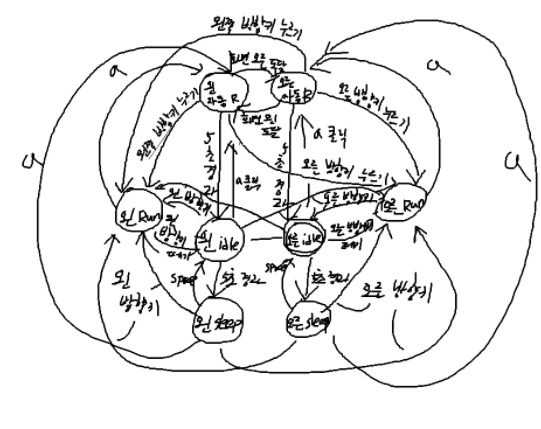

# Drill #11 PRD — 소년 자동 무적 런(AutoRun) 상태 추가

## 1. 개요
LEC12 캐릭터 컨트롤러(Idle / Sleep / Run 상태를 가진 소년)에 **자동 무적 런(AutoRun)** 상태를 추가한다.
상태 패턴으로 구현하며, AutoRun은 반드시 별도의 상태 클래스로 만든다.

## 2. 개발 환경
- Python 3, pico2d
- 실행: `Drill_11` 폴더에서 `python main.py`
- 리소스: `animation_sheet.png`(소년 스프라이트), `grass.png`(바닥)

## 3. 기능 요구사항

| ID | 요구사항 | 배점 |
|---|---|---|
| R1 | Idle 상태에서 `a` 키를 누르면 AutoRun 상태로 전환되고, 키 조작 없이 좌우로 계속 이동한다 | 1 |
| R2 | AutoRun 상태에서 5초 이상 지나면 Idle 상태로 돌아간다 | 1 |
| R3 | AutoRun 상태에서는 속도가 빨라지고 크기가 커진다 | 1 |
| R4 | AutoRun 상태에서 화면 좌우 끝에 닿으면 자동으로 방향을 바꾼다 | 1 |
| R5 | AutoRun 상태에서 방향키를 누르면 AutoRun이 취소되고, 눌린 방향으로 움직이는 Run 상태가 된다 | - |
| R6 | 상태 다이어그램을 그려 저장소에 이미지로 포함한다 | 1 |

기존 동작은 그대로 유지한다.
- Idle에서 5초가 지나면 Sleep, Sleep에서 Space를 누르면 Idle
- Idle/Sleep에서 방향키를 누르면 Run, Run에서 방향키를 모두 떼면 Idle

## 4. 설계

### 4.1 상태 전환

| 현재 상태 | 이벤트 | 다음 상태 |
|---|---|---|
| Idle | 5초 경과 (TIME_OUT) | Sleep |
| Idle | `a` 키 누름 | AutoRun |
| Idle | 방향키 (이동 중) | Run |
| Sleep | Space 누름 | Idle |
| Sleep | `a` 키 누름 | AutoRun |
| Sleep | 방향키 (이동 중) | Run |
| Run | `a` 키 누름 | AutoRun |
| Run | 방향키 (정지) | Idle |
| AutoRun | 5초 경과 (TIME_OUT) | Idle |
| AutoRun | 방향키 누름 | Run |

### 4.2 AutoRun 세부 사양
- 이동 속도: 15 (Run의 5보다 3배 빠름)
- 크기: 2배(200×200), 발이 땅에 닿도록 그리는 y 위치를 50만큼 올린다
- 방향 전환: 커진 몸집의 반폭(100)만큼 화면 끝에서 떨어진 위치에 닿으면 `face_dir`를 뒤집는다
- 진입 시각을 기록해 두고, 5초가 지나면 TIME_OUT 이벤트를 발생시킨다

### 4.3 파일 구성
클래스는 파일 하나에 하나씩 둔다.

| 파일 | 역할 |
|---|---|
| `main.py` | 게임 루프, 월드 생성 |
| `boy.py` | `Boy` — 상태 객체 생성, 전환 규칙, 입력 처리 |
| `state_machine.py` | `StateMachine` — 현재 상태 관리, 이벤트에 따른 전환 |
| `idle.py` | `Idle` 상태 |
| `sleep.py` | `Sleep` 상태 |
| `run.py` | `Run` 상태 |
| `auto_run.py` | `AutoRun` 상태 |
| `grass.py` | `Grass` — 바닥 |

## 5. 검증 방법
1. 실행 후 `a` → 소년이 커지고 빠르게 달리며 화면 양 끝에서 방향이 바뀌는지 확인
2. 5초 기다림 → 원래 크기의 Idle로 돌아오는지 확인
3. 다시 `a` 후 ← 또는 → → 누른 방향으로 걷는 Run이 되는지 확인
4. 기존 동작(Idle → Sleep, Space로 깨기, 방향키로 걷기)이 그대로인지 확인
